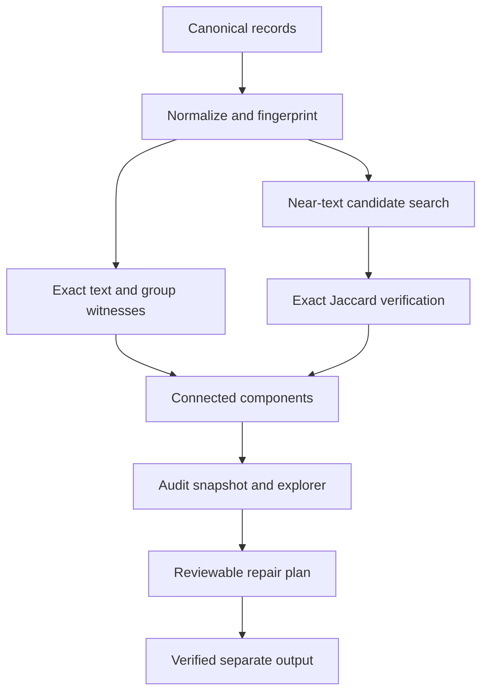

# Holdout Ledger

**Explain text and group leakage. Review a repair plan. Keep the test split intact.**

A high evaluation score is hard to trust when training and test records share
the same content, near-identical templates, or entity. Finding overlap is only the
first step. You also need to explain the finding, preserve the holdout, and
record what changed before retraining.

Holdout Ledger is a local dataset-audit workbench for that workflow. It combines
an auditable Python engine, a CLI, an evidence explorer, persistent SQLite
snapshots, fingerprint-bound repairs, and CI regression checks. The included
demo runs without a model API, GPU, account, or external dataset download.

## Three-minute demo

Python 3.11–3.13:

```bash
python -m venv .venv
source .venv/bin/activate
python -m pip install -e '.[dev]'
holdout-ledger demo --output-dir demo-output
holdout-ledger serve
```

Open `http://127.0.0.1:8000`, click **Load synthetic demo**, then **Run audit**.
The standalone `demo-output/audit.html` also opens directly from disk.

The 14 invented records contain four independent split overlaps, one exact-text
label conflict, a blank record, and a short record. The explorer shows the
record IDs, declared splits, match witnesses, and connected components. Text
previews are opt-in outside the synthetic demo.

## What you can do

| Task | Included behavior |
|---|---|
| Audit split boundaries | Normalized-exact text, verified lexical near matches, and declared entity groups |
| Explain a finding | Interactive witness graph, split membership, labels, and optional text previews |
| Review changes | Explicit removal plan bound to the entire source dataset fingerprint |
| Preserve evaluation | Keep every test record; preserve validation when its component has no test member |
| Publish repaired data | Create a separate directory with split JSONL files and a provenance manifest |
| Compare revisions | Detect new exposed holdout IDs and increased label-conflict counts |
| Enforce a CI policy | Exit nonzero when configured boundary, label, or blank-record limits are exceeded |
| Import Hub data | Bounded streaming sample from a pinned Hugging Face dataset commit |
| Keep audit history | Local SQLite snapshots with pagination and a documented retention limit |

## Input format

Canonical JSONL, one record per line:

```json
{"id":"train-001","text":"The document text","split":"train","label":"category-a","group_id":"entity-17","metadata":{"source":"synthetic"}}
```

`id`, `text`, and `split` are required. IDs must be globally unique across all
input files. Splits are `train`, `validation`, and `test`. Other fields are
optional. CSV supports the same column names; encode `metadata` as JSON.

Use `group_id` for the unit that must stay independent: a person, session,
document family, or other domain-specific entity. A whole source website or
collection can be too broad. Text auditing does not compare image pixels.

## Audit and repair

```bash
holdout-ledger audit examples/records.jsonl \
  --config examples/audit_config.json --output audit.json --html audit.html
holdout-ledger plan audit.json --output review-plan.json
```

Review the evidence and removal IDs before running:

```bash
holdout-ledger apply examples/records.jsonl \
  --plan review-plan.json --output-dir repaired-output
holdout-ledger audit repaired-output/train.jsonl \
  repaired-output/validation.jsonl repaired-output/test.jsonl --output repaired-audit.json
```

The repair rechecks the full source fingerprint and recomputes the plan. Changed
records, edited removal IDs, changed detector configuration, or runtime-version
drift cause rejection. Original files remain untouched. Output paths must not
already exist. The output includes a manifest and the reviewed plan.

The demo repair removes four training records and retains all four test records.
It resolves the detected split overlap. The conflicting labels and blank record
remain flagged for review. It does not silently relabel, rewrite, or delete
holdout examples. Retrain and evaluate before claiming a model improvement.

## Python and CI

```python
from holdout_ledger import AuditConfig, audit, make_plan
from holdout_ledger.demo import demo_records
from holdout_ledger.gates import gate

report = audit(demo_records(), AuditConfig())
print(report.summary)
print(gate(report))
plan = make_plan(report)
```

```bash
holdout-ledger gate audit.json --policy examples/ci_policy.json
holdout-ledger compare baseline-audit.json current-audit.json
```

Exit codes: `0` means the operation succeeded or the check passed; `1` means a
policy or regression check failed; `2` means invalid input or an operational
error. Creating an audit alone does not imply it passed a policy.

`compare` requires the same configuration, candidate mode, and runtime versions.
It compares dataset identities and exposed record IDs, not model accuracy.
Stable IDs across dataset revisions are important for interpreting a delta.

## Hugging Face imports

Install `python -m pip install -e '.[hf]'`. The `import-hf` command requires a
dataset name, its full 40-character commit SHA, the source split, target split,
text column, explicit row limit, and output path. See `holdout-ledger import-hf
--help`. Optional subset, group, and label columns are supported.

The import is a declared bounded sample, not an audit of the entire Hub dataset.
Each record stores the dataset revision, original split, row index, subset, and
sample limit. No remote dataset scripts are executed by this application. The
adapter has contract tests with a controlled stream; live Hub access is not part
of the offline verification suite.

## Detector and architecture



- Unicode NFKC, case folding, and whitespace normalization define exact text.
  Persian ی/ک folding is optional. Case and compatibility folding can be wrong
  for code or case-sensitive identifiers; choose inputs and review accordingly.
- Token shingles define lexical Jaccard similarity. Exhaustive mode checks every
  representative pair within the configured limit. LSH retrieves approximate
  candidates and verifies their exact Jaccard score before reporting a match.
- Exact duplicates and groups use linear witness stars, avoiding quadratic
  cliques. Clusters represent transitive connected components. Membership does
  not imply every pair exceeds the near-match threshold.
- A holdout is exposed when a connected component includes a lower-priority
  split. Priority is test, then validation, then train for preservation. Metrics
  separate witness counts, affected records, and exposed holdout IDs.
- Blank text is flagged rather than indexed as an empty duplicate. Conflicting
  labels are checked on normalized-exact text, not every entity group.
- SHA-256 binds the full source fields, report configuration, and recorded
  environment. These unkeyed hashes detect edits; they are not signatures or
  proof against a malicious artifact author.

## Measured verification

The [legacy local benchmark record](benchmarks/result-local.json) uses 3,000
seeded training records and 200 planted *positive* test records. It reported
all 200 exposed, but included **zero genuinely clean test examples**. Its
false-positive count therefore cannot establish specificity or a false-positive
rate, and this historical JSON must not be interpreted as negative-class
validation. It was not independently rerun in the October 2026 audit.

The revised [labeled synthetic benchmark](benchmarks/benchmark.py) introduces
three positive classes (exact, lexical near-copy, declared group overlap), plus
explicitly clean and hard below-threshold negatives. It reports TP, FP, FN, TN,
denominator-checked precision, recall and false-positive rate for several seeds,
together with input/report checksums, runtime, and seed ranges.

The `--check` option fails if any *planted* positives are missed or *planted*
negative holdouts are flagged. Passing this controlled check is a regression
contract, **not** evidence of sensitivity/specificity on naturally occurring
text, semantic contamination, or medical/psychology cohorts. See
[verification notes](docs/verification.md) and [methodology](docs/methodology.md).

```bash
python benchmarks/benchmark.py --size 120 --injected 6 --negatives 20 \
  --seeds 42,43,44,45,46 --mode lsh --check --output benchmark-lsh.json
ruff check .
ruff format --check .
mypy src
pytest --cov=holdout_ledger --cov-fail-under=90 -q
python -m build
```

The existing [GitHub Actions CI](.github/workflows/ci.yml) runs quality tests
on Python 3.11–3.13 and the Node 24/jsdom dashboard test. As of the
2026-10-09 [successful run](https://github.com/aradmanamnaoon/Holdout-Ledger/actions/runs/37960837739),
the original 45-test suite reached 97.12% statement coverage. That run
predates this benchmark amendment; do not treat it as verification of the new
code until new hosted job logs pass. Current runtime lock files are
`requirements-dev.lock` and `requirements-runtime.lock`; CI's editable
install resolves permitted dependency ranges rather than using those locks.

An optional Node 24 / jsdom test exercises the dashboard and live API. It
does not verify visual rendering or keyboard accessibility.

### Extended GA-02B evidence: baselines and real neuroscience documentation

Beyond the planted positive/negative regression cases, the
[same-input baseline experiment](benchmarks/baseline_comparison.py) compares
normalized-exact, group-only, their union, exhaustive lexical/group reference,
and MinHash LSH/group on **identical** seeded synthetic inputs. The hosted
[GA-02B evidence job](https://github.com/aradmanamnaoon/Holdout-Ledger/actions/runs/38865933203)
recorded 20/60 positives for the exact-only baseline and 60/60 for the full
detector across five explicitly constructed seeds, with 60 true negatives.
These are generator-specific results, not unbiased accuracy estimates.

The separate [real-source probe](benchmarks/real_readme_probe.py) fetched **only**
pinned, public CC0-labeled README text from two OpenNeuro repositories,
audited 24 text excerpts, and found one cross-source exact duplicate component.
It did not load participant files, perform an independent human annotation,
or determine whether a clinical or research evaluation was contaminated.
The artificial split is by README source, and the two related documents
are not independent study datasets.

All source rights, SHA pins, benchmark limits and legal/ethical blockers:
[data and evaluation ledger](docs/evaluation_rights_and_limits.md). A concrete
[blind annotation and subject-level evaluation protocol](docs/independent_evaluation_protocol.md)
is prepared, but independent researchers and permissioned study data have
**not** been obtained. Do not claim independent field validation.

## Deployment and limits

```bash
docker compose up --build
```

The Docker service runs as a non-root user, persists SQLite data, and binds the
host port to loopback. Set `HOLDOUT_LEDGER_TOKEN` before exposing it to others.
The dashboard accepts that bearer token and keeps it only in the current tab.
The API is a single-workspace service, not a multi-tenant platform.

API bodies are capped at 5 MiB and 5,000 records. CLI audits default to 100,000
records. The engine materializes records, shingles, and the LSH index in RAM;
streamed ingestion does not make the audit constant-memory. Record, edge, and
candidate limits abort rather than returning a silently truncated report.
Snapshots have a default retention of the most recent 100 audits. The same
SQLite database must be shared by server workers. Data never leaves this service
unless you explicitly use the Hub import or export an artifact.

Not covered: semantic paraphrases with little lexical overlap, temporal leakage,
feature preprocessing leakage, undisclosed entities, image similarity, and
contamination from training data you cannot inspect. Absence of a finding is
not proof of an uncontaminated benchmark. See [methodology](docs/methodology.md).

## How it fits existing tools

[DataTrove](https://github.com/huggingface/datatrove) and
[Data-Juicer](https://github.com/datajuicer/data-juicer) support broader data
processing and large-scale deduplication. Holdout Ledger focuses on inspecting
existing split boundaries, preserving evaluation records, producing reviewed
repair artifacts, and making revision-level changes visible in local workflows.
It is not a replacement for distributed corpus processing.

See [architecture](docs/architecture.md), [API](docs/api.md),
[contributing](CONTRIBUTING.md), and [research notes](docs/research.md).

MIT license.
